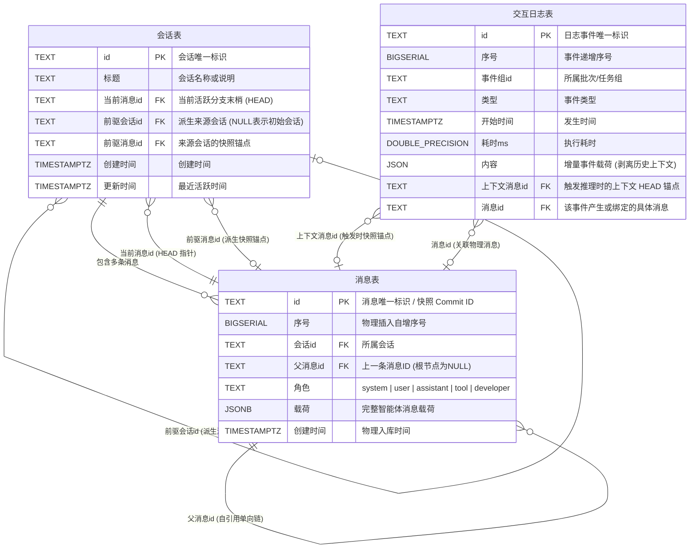
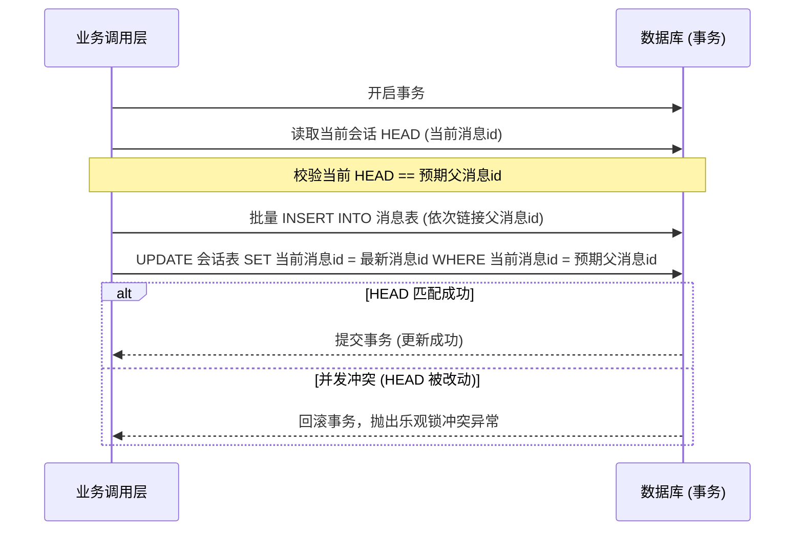
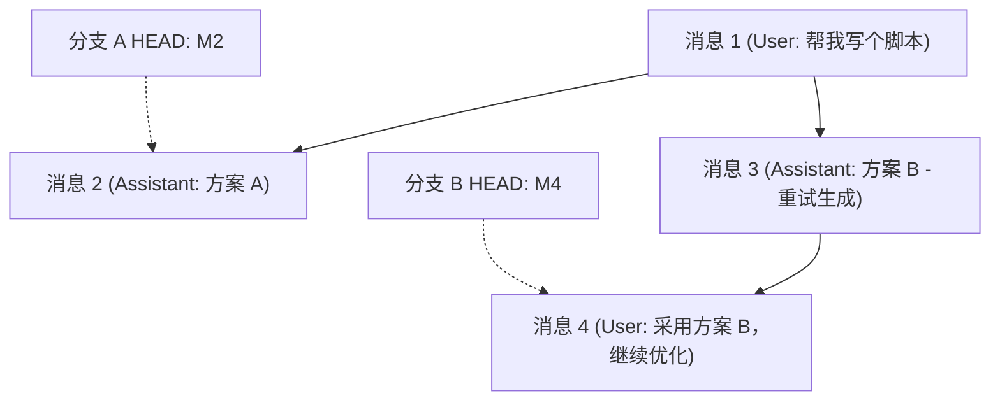

# 会话与消息体系技术设计方案

## 1. 概述与核心目标

### 1.1 背景与痛点

在传统的智能体记忆架构中，对话上下文往往完全由外部调用方在内存中维护，数据库仅持久化结构化记忆图谱和操作日志。这种模式存在明显的架构缺陷：

1. **交互日志体积冗余严重**：每次执行模型推理与审计时，需将多轮历史消息完整序列化写入日志字段。随着轮次累加，存储占用呈平方级增长。
2. **缺乏不可变的历史版本追溯**：历史消息未在数据库层实现原子化快照，外部系统难以低成本实现消息分叉（Fork）、撤回与局部重试。
3. **上下文压缩与历史回溯冲突**：长对话面临上下文窗口超限时，若直接截断或就地改写消息，会破坏历史会话的真实可审计性，缺乏标准化的派生归档与按需回溯机制。

### 1.2 核心设计理念

本方案遵循 **“每条消息自成提交（Message-as-a-Commit）”** 的设计哲学：

- **单行单消息**：严格以单条消息为原子行进行持久化，完整记录 `system`、`user`、`assistant`、`tool` 等各角色的时序交互过程。
- **单向不可变有向无环图（Merkle DAG）**：消息通过指向前驱的 `父消息id` 链接成链。任意消息 ID 即代表截止该时刻的不可变历史快照（Commit 锚点）。
- **派生式会话压缩（Fork-on-Compact）**：上下文压缩不破坏、不修改任何既有消息链，而是从原会话的特定消息快照派生出新会话，保证历史审计链路物理只读。
- **谱系安全边界**：为智能体提供专用的历史阅读工具，且该工具严格限定在当前会话及其前驱节点组成的谱系内，避免越权读取无关会话。

### 1.3 核心约束原则

1. **只追加、禁更新删除（Append-Only）**：消息和交互日志严格只允许追加写入，禁止修改或删除；会话禁止删除，仅允许更新标题、当前活跃指针（HEAD）与更新时间。
2. **严格外键约束**：所有关联外键统一采用 `ON DELETE RESTRICT`，严禁级联删除或隐式置空（`SET NULL`）。
3. **原子载荷保真**：消息体以完整的 `JSONB` 格式存储，角色单独建列用于约束与检索，确保第三方模型商的扩展字段原样往返。
4. **短事务与乐观并发控制**：消息追加与会话 HEAD 推进必须在同一数据库短事务内完成，并通过预期父消息 ID 执行乐观并发校验；模型网络调用严禁进入数据库事务。

---

## 2. 数据库模型设计

### 2.1 实体关系模型 (ER)



### 2.2 会话表 (`会话表`)

维护会话的生命周期、当前分支指针（HEAD）及派生谱系关系。

| 字段名       | 类型          | 约束                                                | 说明                                                                            |
| :----------- | :------------ | :-------------------------------------------------- | :------------------------------------------------------------------------------ |
| `id`         | `TEXT`        | `PRIMARY KEY`                                       | 会话唯一标识（UUID）。                                                          |
| `标题`       | `TEXT`        | `NOT NULL DEFAULT ''`                               | 会话名称或简述。                                                                |
| `当前消息id` | `TEXT`        | `NULLABLE REFERENCES 消息表(id) ON DELETE RESTRICT` | 当前活跃分支的最新消息指针（相当于 Git HEAD）。初始为 `NULL`。                  |
| `前驱会话id` | `TEXT`        | `NULLABLE REFERENCES 会话表(id) ON DELETE RESTRICT` | 派生会话的来源会话 ID。与 `前驱消息id` 必须同时为空或同时非空，且不能指向自身。 |
| `前驱消息id` | `TEXT`        | `NULLABLE REFERENCES 消息表(id) ON DELETE RESTRICT` | 来源会话被派生时的快照锚点消息 ID，创建后只读不可变。                           |
| `创建时间`   | `TIMESTAMPTZ` | `NOT NULL`                                          | 会话建立时间。                                                                  |
| `更新时间`   | `TIMESTAMPTZ` | `NOT NULL`                                          | 会话最近活跃或更新时间。                                                        |

### 2.3 消息表 (`消息表`)

作为最细粒度的原子操作记录，通过 `父消息id` 构成树状不可变历史链。

| 字段名     | 类型          | 约束                                                | 说明                                                                                   |
| :--------- | :------------ | :-------------------------------------------------- | :------------------------------------------------------------------------------------- |
| `id`       | `TEXT`        | `PRIMARY KEY`                                       | 消息唯一标识（UUID），同时代表该时刻上下文的快照锚点。                                 |
| `序号`     | `BIGSERIAL`   | `NOT NULL`                                          | 物理写入时序自增序号。                                                                 |
| `会话id`   | `TEXT`        | `NOT NULL REFERENCES 会话表(id) ON DELETE RESTRICT` | 所属会话 ID。                                                                          |
| `父消息id` | `TEXT`        | `NULLABLE REFERENCES 消息表(id) ON DELETE RESTRICT` | 同一会话内的前驱消息 ID，会话根消息为 `NULL`。                                         |
| `角色`     | `TEXT`        | `NOT NULL`                                          | 约束取值：`'system'`、`'developer'`、`'user'`、`'assistant'`、`'tool'`、`'function'`。 |
| `载荷`     | `JSONB`       | `NOT NULL`                                          | 完整的 `智能体消息类型`，原样持久化所有治理与模型扩展字段。                            |
| `创建时间` | `TIMESTAMPTZ` | `NOT NULL`                                          | 物理写入时间。                                                                         |

### 2.4 交互日志关联设计 (`交互日志表`)

为消除交互日志全量复制历史消息的存储冗余，日志表与消息表通过外键直接关联：

- **`上下文消息id`**：记录发起大模型调用或审计时的上下文快照末梢（即当时的 `会话.当前消息id`）。需要回溯请求现场时，直接以此锚点递归上溯即可还原完整上下文。
- **`消息id`**：若该日志事件本身对应某条消息的生成（如 assistant 回复或 tool 执行结果入库），则直接关联该物理消息。
- **`内容` 字段瘦身**：移除历史消息数组，仅记录事件本身的增量数据（如入参、出参、耗时、模型调优参数等）。

---

## 3. 核心机制与业务流转

### 3.1 消息追加与乐观并发控制

智能体消息写入严格遵循短事务原则：

1. 校验会话当前 HEAD 是否等于调用方预期的父消息 ID（`预期父消息id`）。
2. 在同一事务内按序写入新消息列表，每条消息的前驱指向前一条。
3. 更新 `会话表.当前消息id` 为最新消息 ID，更新 `更新时间`，并附加条件 `WHERE 当前消息id = 预期父消息id`（CAS 乐观锁）。
4. 若受影响行数不为 1，则触发并发冲突异常，避免多并发分支静默覆盖。



### 3.2 上下文回溯机制

当需要将数据库中的消息链接还原为大模型所需的线性消息数组时，利用 PostgreSQL 递归 CTE 向上遍历：

```sql
WITH RECURSIVE 消息链 AS (
  -- 锚点：从指定的末梢消息开始（如会话表.当前消息id）
  SELECT m.*, 0 AS 深度
  FROM 消息表 m
  WHERE m.id = $1
  UNION ALL
  -- 递归：沿父消息id向上寻找前驱
  SELECT p.*, c.深度 + 1 AS 深度
  FROM 消息表 p
  JOIN 消息链 c ON p.id = c.父消息id
  WHERE c.深度 + 1 < $2 -- 最大回溯条数限制
)
SELECT * FROM 消息链 ORDER BY 深度 DESC;
```

应用层拉取结果按深度倒序排列，即可得到严格保真的、由早到晚的完整上下文消息列表。

### 3.3 分支派生与重试 (Fork & Retry)

当用户选择“重新生成回复”或撤回至历史某一步时，数据库无需拷贝历史数据，只需在分支点长出新节点：



- **生成重试**：新回复 `M3` 的 `父消息id` 直接指向分叉点 `M1`。
- **分支检出**：将 `会话表.当前消息id` 更新为 `M3.id` 或 `M4.id`，即可实现秒级分支切换。

### 3.4 会话上下文压缩与派生 (Fork-on-Compact)

当上下文长度逼近模型窗口上限时，系统不修改原会话的任何记录，而是采用**派生新会话**的方式完成平滑截断与归档：

```mermaid
flowchart TD
    subgraph 原会话: session_1 (已归档快照)
        S1_M1["M1: System Prompt"] --> S1_M2["M2: User 提问"]
        S1_M2 --> S1_M3["M3: Assistant 回复"]
        S1_M3 --> S1_M4["M4: User 继续讨论 (HEAD)"]
    end

    subgraph 派生会话: session_2 (当前活跃)
        S2_M1["M5: 复用 System Prompt"] --> S2_M2["M6: System 归档摘要消息<br/>(绑定前驱会话与前驱快照锚点)"]
        S2_M2 --> S2_M3["M7: 新轮次 User 提问 (HEAD)"]
    end

    session_2 -. "前驱会话id: session_1<br/>前驱消息id: S1_M4" .-> S1_M4
```

#### 压缩实施步骤

1. **快照锚定**：以原会话当前的 HEAD 消息作为不可变快照锚点 `前驱消息id`。
2. **创建派生会话**：新建会话记录，显式填入 `前驱会话id` 与 `前驱消息id`。
3. **初始化前缀**：新会话复制原会话的根系统提示（System Prompt），并追加一条带有压缩元数据（`compressionSourceSessionId`、`compressionSourceMessageId`）的摘要系统消息。
4. **会话切换**：将活跃上下文指针切换至新会话，后续交互在新会话中继续推进，原会话永久保持不可变快照状态。

压缩过程会写入交互日志（`流程开始`、`模型请求审计`、`流程结束` 或 `流程异常`），自动压缩与正式那一轮共用同一个事件组，详见 [高级存储、并发与配置指南](./advanced-storage-and-config.md) 的“自动压缩遥测与模型请求审计字段”。

要找出某个会话派生出的所有会话，使用 `查询派生会话(前驱会话id)`：返回 `前驱会话id` 等于它的会话，按更新时间倒序，没有则返回空数组。它与 `查询会话列表` 同样是公开方法。

### 3.5 智能体谱系历史阅读工具 (`read_conversation_history`)

为了使上下文压缩后的智能体依然具备回看早期细节的能力，系统为智能体注册历史阅读工具。

#### 工具接口定义

```typescript
{
  名称: 'read_conversation_history',
  描述: '读取当前会话或其不可变前驱会话中的历史原文。只能读取当前会话谱系上的消息。',
  参数Schema: {
    目标消息id: string,       // 需要追溯的目标消息ID
    向上回溯条数: number,     // 向上回溯拉取的消息数量（1~50，默认 10）
  },
  返回值Schema: {
    结果: '成功' | '失败',
    错误信息?: string,
    消息列表?: Array<{
      id: string,
      会话id: string,
      角色: string,
      内容: string | null,
      创建时间: string,
    }>
  }
}
```

#### 谱系安全校验逻辑

1. 从当前活跃会话出发，沿着 `前驱会话id` 与 `前驱消息id` 形成可信的**会话谱系树**。
2. 仅在谱系覆盖的不可变消息链中查找 `目标消息id`。
3. 若目标消息不存在于当前谱系中，拒绝读取并返回失败，防止模型越权探测其他隔离会话的历史内容。

---

## 4. 索引与性能保障

为保证高并发和长对话场景下的毫秒级检索响应，数据库建立以下关键索引：

| 索引名称                    | 索引字段              | 用途说明                                         |
| :-------------------------- | :-------------------- | :----------------------------------------------- |
| `会话表_更新时间_idx`       | `(更新时间 DESC, id)` | 支撑会话列表按最近活跃时间倒序分页展示。         |
| `会话表_前驱会话_idx`       | `(前驱会话id)`        | 快速检索会话谱系与所有派生子会话。               |
| `消息表_会话序号_idx`       | `(会话id, 序号)`      | 会话内消息的物理顺序流式导出与快照打包。         |
| `消息表_父消息_idx`         | `(父消息id)`          | 快速查找指定消息的所有分支分叉（Child Nodes）。  |
| `交互日志表_上下文消息_idx` | `(上下文消息id)`      | 审计时通过上下文快照锚点反查该请求的所有日志。   |
| `交互日志表_消息_idx`       | `(消息id)`            | 定位具体单条消息关联的生成耗时、日志和调试明细。 |

---

## 5. 方案总结

本技术方案将对话历史抽象为纯粹的 **不可变 Merkle DAG 消息链**，实现了以下核心收益：

1. **纯粹与解耦**：仅引入 `会话表` 与 `消息表`，无冗余中间抽象，天然适配大模型标准消息结构。
2. **彻底消冗**：日志剥离全量历史，通过 `上下文消息id` 和 `消息id` 关联物理快照，杜绝存储膨胀。
3. **无损长上下文**：通过派生会话（Fork-on-Compact）机制实现物理级无损压缩；配合谱系历史阅读工具，智能体在保持低 Token 消耗的同时，依然具备全局不可变回溯能力。
